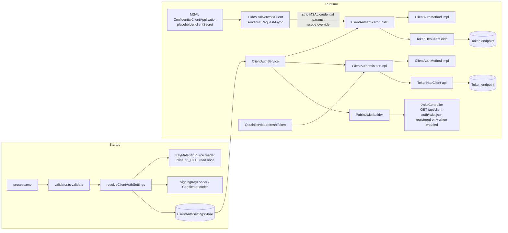
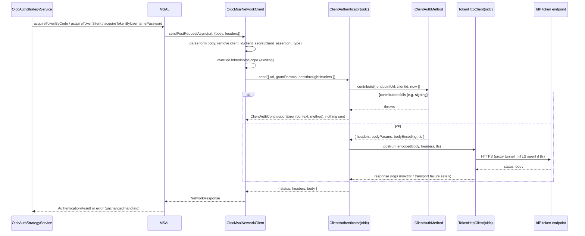

# Design Document: OAuth Client Authentication Methods

## Overview

FCC sends OAuth 2.0 token requests from two places. Each one builds its client credentials differently:

- **OIDC_Client**: `OidcAuthStrategyService` uses `@azure/msal-node` 3.8.7 `ConfidentialClientApplication`. FCC supplies a custom `networkClient` built on axios. MSAL builds the form body itself, including `client_secret` or `client_assertion`.
- **API_Auth_Client**: `OauthService.refreshToken` posts a JSON body containing `client_id` and `client_secret`. `AuthenticationModule` always calls it with `contentType: 'json'`.

This design adds a **Client_Auth_Framework** under `apps/server/src/auth/client-auth/`. It owns three things for both Client_Contexts:

1. **Configuration resolution and validation**: method, secrets, keys, JWKS, certificates and file sources. Everything is resolved and validated once at startup, inside the existing `validate` hook.
2. **Client credential contribution**: one `ClientAuthMethod` interface. It returns headers, body parameters, body encoding and TLS options. Six method names map onto five implementations.
3. **Token request transport**: one `TokenHttpClient` per Client_Context. It handles proxying, per-context mTLS agents, error categorisation and safe logging.

### Key design decisions

| Decision | Rationale |
|---|---|
| **MSAL keeps building grant parameters, and the framework owns the credential.** MSAL is configured with a fixed placeholder `clientSecret`. The FCC network client strips every client credential parameter MSAL adds (`client_id`, `client_secret`, `client_assertion`, `client_assertion_type`). It then applies the framework contribution and sends the request through `TokenHttpClient`. | MSAL 3.8.7 requires exactly one of `clientSecret`, `clientAssertion` or `clientCertificate` (`ConfidentialClientApplication.mjs` L42–70). It has no option for HTTP Basic or mTLS. The only hook that can change headers, body and TLS on every token request is `system.networkClient.sendPostRequestAsync(url, { body, headers })`. Rewriting there covers code exchange, refresh (`acquireTokenSilent`) and username/password in one place (Req 3.2, 12.1). PKCE, scope, `redirect_uri`, `client_info` and the rest of MSAL's grant handling stay unchanged (Req 12.2–12.4). |
| **The placeholder secret is a constant non-credential string** (`fcc-client-auth-framework-placeholder`). | It satisfies MSAL's constructor check. It is always stripped before sending, so the real secret never passes through MSAL. MSAL's own logging and errors therefore cannot leak the real secret. |
| **`private_key_jwt` assertions are signed inside the network client for every POST**, not by MSAL's `clientAssertion` callback. | One code path for both contexts. A fresh assertion is created on every send, including MSAL retries (Req 6.1). `aud` comes from the configured endpoint string, which keeps Legacy_Behaviour (Req 1.5). |
| **The legacy `client_secret` method is a separate implementation that depends on the context**: form body for OIDC, JSON for API. | This keeps today's wire formats as the defaults (Req 1.1–1.4). |
| **mTLS uses a dedicated agent per Client_Context.** That agent is used only for token POSTs of that context. | Userinfo GETs and Fluxnova API calls keep their existing agents, so the certificate never leaks onto them (Req 9.7). |
| **Through a proxy, the client certificate goes only into the tunnelled TLS session.** A subclass of `HttpsProxyAgent` merges the TLS client options into the per-request `opts` in `connect()`. It never passes them through the constructor. | Verified in `https-proxy-agent@7.0.6/dist/index.js`. Constructor options go into `this.connectOpts`, which is used for `tls.connect` to an `https://` proxy (L75–96). Per-request `opts` are used only for the TLS upgrade to the destination after `CONNECT` (L132–135). Passing the certificate through the constructor would present it to an HTTPS proxy, which violates Req 9.6. |
| **No new runtime dependencies.** Node 24 `crypto` handles PEM and JWK import/export (`createPrivateKey({format:'jwk'})`, `KeyObject.export({format:'jwk'})`), `X509Certificate` handles `checkPrivateKey`, `validFromDate`/`validToDate` and `raw`, and `tls.getCACertificates('default')` provides the default trust store. The existing `jsonwebtoken` 9 signs RS256, PS256 and ES256 and accepts `KeyObject`. | Smaller supply-chain surface, and the existing assertion code already uses `jsonwebtoken`. |
| **New dev dependencies, pinned to exact versions:** `fast-check` (PBT) and `@peculiar/x509` (generates test certificates at runtime). | No PBT library exists in the repo today. Committed certificate fixtures would expire and break Req 9.10/9.11 tests. |
| **Validation collects every client-auth problem and throws one aggregated `Error`** with one line per problem. | Operators fix everything in one restart. Each line still names the variable, `kid`, position or path the requirement asks for. |
| **Resolved settings are memoised in a module-level store.** `validate()` fills the store, and later consumers read it. | Each `_FILE` source is read exactly once (Req 10.8). `ConfigModule.forRoot({ validate })` runs before the `registerAs` factories are evaluated. |

### Research findings

- **MSAL Node 3.8.7.** Exactly one credential type must be set (`ConfidentialClientApplication.mjs` L42–70). Custom `networkClient.sendPostRequestAsync(url, options)` receives a form-encoded string body and MSAL headers. FCC's `overrideTokenBodyScope` already relies on this. `authorityMetadata.token_endpoint` sets the URL MSAL posts to. [MSAL Node configuration](https://learn.microsoft.com/en-us/entra/msal/javascript/node/configuration)
- **RFC 6749 §2.3.1.** The Basic credentials are `application/x-www-form-urlencoded` (Appendix B) encodings of the client ID and secret, joined by `:` and base64 encoded. A client must not use more than one authentication method per request. [RFC 6749](https://www.rfc-editor.org/rfc/rfc6749#section-2.3.1)
- **RFC 7523 / OIDC Core §9.** `private_key_jwt` requires `iss` and `sub` equal to `client_id`, `aud` set to the token endpoint, `jti` and `exp`, with `client_assertion_type=urn:ietf:params:oauth:client-assertion-type:jwt-bearer`. [OIDC Core §9](https://openid.net/specs/openid-connect-core-1_0.html#ClientAuthentication)
- **RFC 8705 §2.** `tls_client_auth` (PKI) and `self_signed_tls_client_auth` look the same on the client side. Both present a certificate and send `client_id` in the body. The difference is how the authorization server binds the certificate. An AS may publish `mtls_endpoint_aliases`. [RFC 8705](https://www.rfc-editor.org/rfc/rfc8705#section-2)
- **RFC 7517 / RFC 7638.** JWK Set format. The RFC 7638 thumbprint gives a canonical identity for a public key, which is used to de-duplicate the Public_JWKS. [RFC 7638](https://www.rfc-editor.org/rfc/rfc7638)
- **RFC 7515 §4.1.7–4.1.8.** `x5t` and `x5t#S256` are the base64url SHA-1 and SHA-256 digests of the DER certificate.
- **Node TLS.** When the `ca` option is set, it *replaces* the default trust store. To satisfy "configured bundle **or** default store" (Req 9.3), set `ca = [...tls.getCACertificates('default'), ...bundle]`. The `'default'` set includes `NODE_EXTRA_CA_CERTS`. [Node tls docs](https://nodejs.org/api/tls.html#tlsgetcacertificatestype)

## Architecture



### Token request sequence (OIDC)



### Module layout

```
apps/server/src/auth/client-auth/
  client-auth.module.ts           ClientAuthModule.register(): providers + conditional JwksController
  client-auth.service.ts          ClientAuthService: authenticators, startup log, public JWKS
  client-authenticator.ts         ClientAuthenticator: contribution + encoding + transport per context
  client-auth.types.ts            shared types (below)
  client-auth.errors.ts           ClientAuthContributionError, TokenRequestError, ClientAuthConfigError
  methods/
    method-registry.ts            name -> factory
    legacy-client-secret.method.ts
    client-secret-basic.method.ts
    client-secret-post.method.ts
    private-key-jwt.method.ts
    tls-client-auth.method.ts     tls_client_auth + self_signed_tls_client_auth
  encoding/
    form-encoding.ts              formUrlEncode / formUrlDecode (RFC 6749 App. B)
    basic-credentials.ts          buildBasicAuthorization / parseBasicAuthorization
    request-body.ts               encodeBody(params, 'form' | 'json')
  keys/
    signing-key.ts                loadSigningKeys (PEM | JWKS), checkKeyForAlgorithm
    client-assertion.ts           signClientAssertion
    public-jwks.ts                buildPublicJwks, toPublicJwk, jwkThumbprint (RFC 7638)
    certificate.ts                loadCertificate, thumbprints, validity, CA bundle
  config/
    env-names.ts                  per-context env variable name table
    key-material-source.ts        resolveMaterial(inline, _FILE) with fs abstraction
    resolve-client-auth-settings.ts  env -> ResolvedClientAuthSettings | issues[]
    client-auth-settings.store.ts memoised settings
    client-auth.config.ts         registerAs('clientAuth', ...)
  transport/
    token-http-client.ts          axios instance per context, error categorisation, safe logging
    mtls-https-proxy-agent.ts     HttpsProxyAgent subclass that injects TLS opts only into the tunnel
  jwks.controller.ts              @Public() GET /api/client-auth/jwks.json
apps/server/src/auth/strategies/
  oidc-msal-network-client.ts     extracted network client (GET unchanged, POST through the framework)
```

`private-key-jwt.ts` is removed and replaced by `keys/client-assertion.ts`. `validator.ts` keeps its non-client-auth checks and delegates every client credential check to `validateClientAuth(env)`.

## Components and Interfaces

### Environment variable table (`config/env-names.ts`)

`P` is `FXN_OIDC` for the OIDC_Client and `FXN_API_AUTH` for the API_Auth_Client. Names marked † already exist. Every item marked "file" also accepts `<NAME>_FILE`.

| Purpose | OIDC_Client | API_Auth_Client | File |
|---|---|---|---|
| Method | `FXN_OIDC_CLIENT_AUTH_METHOD` † | `FXN_API_AUTH_CLIENT_AUTH_METHOD` | – |
| Client ID | `FXN_OIDC_CLIENT_ID` † | `FXN_API_AUTH_CLIENT_ID` † | – |
| Token URL | `FXN_OIDC_TOKEN_URL` † | `FXN_API_AUTH_TOKEN_URL` † | – |
| Client secret | `FXN_OIDC_CLIENT_SECRET` † | `FXN_API_AUTH_CLIENT_SECRET` † | yes |
| PEM Signing_Key | `FXN_OIDC_PRIVATE_KEY` † | `FXN_API_AUTH_PRIVATE_KEY` | yes |
| Private_JWKS | `P_PRIVATE_JWKS` | `P_PRIVATE_JWKS` | yes |
| Signing algorithm | `FXN_OIDC_PRIVATE_KEY_JWT_ALGORITHM` † | `FXN_API_AUTH_PRIVATE_KEY_JWT_ALGORITHM` | – |
| `kid` (PEM) / active `kid` (JWKS) | `FXN_OIDC_KEY_ID` † | `FXN_API_AUTH_KEY_ID` | – |
| Assertion certificate (for `x5t#S256`) | `P_ASSERTION_CERTIFICATE` | `P_ASSERTION_CERTIFICATE` | yes |
| Include SHA-1 `x5t` | `P_ASSERTION_INCLUDE_X5T` (`true`/unset) | same | – |
| Assertion audience override | `P_ASSERTION_AUDIENCE` | same | – |
| mTLS client certificate | `P_TLS_CLIENT_CERTIFICATE` | same | yes |
| mTLS client private key | `P_TLS_CLIENT_KEY` | same | yes |
| mTLS key passphrase | `P_TLS_CLIENT_KEY_PASSPHRASE` | same | yes |
| CA bundle for the token endpoint | `P_TLS_CA_BUNDLE` | same | yes |
| mTLS token endpoint alias | `P_MTLS_TOKEN_URL` | same | – |
| JWKS endpoint (shared) | `FXN_CLIENT_AUTH_JWKS_ENDPOINT_ENABLED` (`true` enables; default disabled) | | – |

The existing `FXN_OIDC_KEY_ID` keeps its meaning as the assertion `kid` for a PEM key (Req 1.5, 1.8). When a Private_JWKS is configured, it selects the Active_Key instead. For a JWKS key, the assertion certificate comes from that key's `x5c[0]`. `P_ASSERTION_CERTIFICATE` applies only to a PEM Signing_Key. Setting it together with a Private_JWKS is reported as a conflict.

### Core types (`client-auth.types.ts`)

```ts
export type ClientContextName = 'oidc' | 'api';

export type ClientAuthMethodName =
  | 'client_secret'
  | 'client_secret_basic'
  | 'client_secret_post'
  | 'private_key_jwt'
  | 'tls_client_auth'
  | 'self_signed_tls_client_auth';

export const CLIENT_AUTH_METHOD_NAMES: readonly ClientAuthMethodName[] = [/* the six above, in this order */];

export type SupportedSigningAlgorithm = 'RS256' | 'PS256' | 'ES256';

export type BodyEncoding = 'form' | 'json';

/** TLS options applied only to the TLS session with the token endpoint. */
export interface TlsClientOptions {
  cert?: string;          // PEM chain
  key?: string;           // decrypted PKCS#8 PEM (decrypted at startup)
  ca?: string[];          // default trust store + configured bundle
}

/** What a method adds to a token request. */
export interface ClientAuthContribution {
  headers: Record<string, string>;
  bodyParams: Record<string, string>;
  bodyEncoding: BodyEncoding;
  tls?: TlsClientOptions;
}

export interface ContributionInput {
  /** Configured endpoint URL string (query excluded) this request targets. */
  endpointUrl: string;
  now: () => number;      // ms since epoch; injectable for tests
}

/** The single pluggable interface (Req 3.1). */
export interface ClientAuthMethod {
  readonly name: ClientAuthMethodName;
  contribute(input: ContributionInput): Promise<ClientAuthContribution>;
}
```

### Method implementations

| Method | headers | bodyParams | encoding | tls |
|---|---|---|---|---|
| `client_secret` (OIDC) | – | `client_id`, `client_secret` | form | CA bundle only, if configured |
| `client_secret` (API) | – | `client_id`, `client_secret` | json | CA bundle only, if configured |
| `client_secret_basic` | `Authorization: Basic …` | – | form | CA bundle only, if configured |
| `client_secret_post` | – | `client_id`, `client_secret` | form | CA bundle only, if configured |
| `private_key_jwt` | – | `client_id`, `client_assertion_type`, `client_assertion` | form | CA bundle only, if configured |
| `tls_client_auth` / `self_signed_tls_client_auth` | – | `client_id` | form | cert, key and CA |

Under every non-JSON method, the framework sets `Content-Type: application/x-www-form-urlencoded`. Under API legacy it sets `Content-Type: application/json`. Method contributions are merged *after* grant parameters, with credential keys always taken from the contribution. Any `Authorization` header MSAL passes through is dropped.

`ClientSecretBasicMethod.contribute` returns `Authorization: 'Basic ' + base64(formUrlEncode(id) + ':' + formUrlEncode(secret))`. `formUrlEncode` serialises one value with `URLSearchParams`, so space becomes `+` and every reserved byte is percent-encoded. This is the Appendix B algorithm.

`PrivateKeyJwtMethod.contribute` calls `signClientAssertion` with:

```ts
interface AssertionSigningInput {
  clientId: string;
  audience: string;              // audienceOverride ?? endpointUrl
  algorithm: SupportedSigningAlgorithm;
  key: KeyObject;                // Active_Key private
  kid?: string;
  certificate?: X509Certificate; // Active_Key certificate (PEM var or JWK x5c[0])
  includeX5t: boolean;
  nowSeconds: number;            // Math.floor(now()/1000)
  jti: string;                   // crypto.randomUUID()
}
// header: { alg, typ: 'JWT', kid?, 'x5t#S256'?, x5t? }
// payload: exactly { iss, sub, aud, iat, exp: iat + 60, jti }
```

It uses `jsonwebtoken.sign(payload, key, { algorithm, header, noTimestamp: true })`. `iat` is set explicitly, so the payload has exactly the six claims (Req 1.5). If signing throws, the method throws `ClientAuthContributionError(context, method, 'client assertion signing failed')` with no `cause` (Req 3.7, 6.15).

### ClientAuthenticator

```ts
export interface TokenRequestInput {
  url: string;                              // URL to POST to (may include query from MSAL)
  grantParams: Record<string, string>;      // grant_type, code, code_verifier, refresh_token, scope, ...
  passthroughHeaders?: Record<string, string>; // MSAL telemetry headers etc. (no auth / content-type)
}

export interface TokenResponse { status: number; headers: Record<string, unknown>; body: unknown; }

export class ClientAuthenticator {
  readonly context: ClientContextName;
  readonly method: ClientAuthMethodName;
  readonly tokenUrl: string;               // effective: mtlsTokenUrl ?? tokenUrl
  send(input: TokenRequestInput): Promise<TokenResponse>;
}
```

`send` performs these steps:

1. `contribution = await method.contribute({ endpointUrl: this.tokenUrl, now })`. If it throws, log one error entry `{context, method}` and rethrow. No HTTP call is made.
2. Build `params = { ...grantParams, ...contribution.bodyParams }` and drop any credential key the contribution did not supply.
3. Build headers: `passthroughHeaders` minus `authorization`/`content-type`, then the content type for the encoding, then `contribution.headers`.
4. Call `TokenHttpClient.post(url, encodeBody(params, encoding), headers, contribution.tls)`.

### OidcMsalNetworkClient (`strategies/oidc-msal-network-client.ts`)

- `sendGetRequestAsync` is unchanged and uses the existing plain proxy axios instance.
- `sendPostRequestAsync(url, { body, headers })`:
  1. `params = new URLSearchParams(body)` and delete `client_id`, `client_secret`, `client_assertion` and `client_assertion_type`.
  2. Apply `overrideTokenBodyScope` (existing). `isTokenEndpoint` compares against the *effective* token URL.
  3. Call `authenticator.send({ url, grantParams: Object.fromEntries(params), passthroughHeaders: headers })`.
  4. Return `{ status, headers, body }` so MSAL handles server errors as it does today (Req 12.6, 12.7).
  5. If `send` throws `TokenRequestError` (transport failure), return the synthetic `{ status: 500, body: { error: 'token_request_failed', error_description: <category> } }`. This keeps today's shape without the raw `err.message`. If it throws `ClientAuthContributionError`, rethrow so MSAL rejects the acquire call.

`buildMsalConfig` changes as follows: `auth.clientSecret = PLACEHOLDER` for every method. `clientAssertion` is never set. `authorityMetadata.token_endpoint = authenticator.tokenUrl`. The `else throw 'Unsupported OIDC client authentication method'` branch is removed, because validation guarantees the value is valid.

### OauthService / AuthenticationModule (API_Auth_Client)

- `GetTokenParams` becomes `{ tokenUri: string; clientId?: string; scope?: string }`. `clientSecret` and `contentType` are removed so no credential is added outside the framework (Req 3.3).
- `refreshToken(params)` calls `clientAuthService.forContext('api').send({ url: params.tokenUri, grantParams: { grant_type: 'client_credentials', ...(params.scope !== undefined ? { scope: params.scope } : {}) } })`. Non-2xx and transport failures throw `FluxnovaError('Error getting Oauth token from: <url> with client Id: <id>')` with **no `cause`**. The old `cause` carried the AxiosError, whose `config.data` and `config.headers` contain the secret or `Authorization` header (Req 11.1). The framework has already written the diagnostic log entry.
- Today `AuthenticationModule` passes no `scope`, so `JSON.stringify` drops it. That stays the same: `scope` is included only when defined, in both JSON and form encodings (Req 1.3).
- The 5000 ms timeout is kept for the API context. The OIDC context keeps no timeout.

### TokenHttpClient (`transport/token-http-client.ts`)

One instance per Client_Context, created at startup.

```ts
class TokenHttpClient {
  constructor(context: ClientContextName, method: ClientAuthMethodName, clientId: string,
              proxyUrl: string | undefined, timeoutMs: number | undefined, logger: Logger);
  post(url: string, body: string, headers: Record<string,string>, tls?: TlsClientOptions): Promise<TokenResponse>;
}
```

Agent selection (memoised per `tls` identity):

| proxy | tls | httpsAgent |
|---|---|---|
| none | none | `undefined` (Node default) |
| none | set | `new https.Agent({ ...tls, keepAlive: true })` |
| set | none | `new HttpsProxyAgent(proxyUrl)` (today's behaviour) |
| set | set | `new MtlsHttpsProxyAgent(proxyUrl, tls)` |

`httpAgent` is `HttpProxyAgent(proxyUrl)` when a proxy is set. `proxy: false` always. The proxy URL is `http_proxy || HTTP_PROXY`, read from `ConfigService` exactly as today, with empty values treated as unset (Req 3.5, 3.6).

`MtlsHttpsProxyAgent extends HttpsProxyAgent` overrides `connect(req, opts)` to return `super.connect(req, { ...opts, ...tls })`. The proxy socket comes from `this.connectOpts`, which never contains the client certificate. A unit test asserts this against a local CONNECT proxy (see Testing Strategy), so a future `https-proxy-agent` upgrade that changes the internals fails CI.

Response handling uses `validateStatus: () => true`:

- For a non-2xx response, log one error entry `{context, method, tokenUrl, clientId, status}` (Req 11.2) and return the response.
- For a thrown axios error with no response, categorise it as `timeout` (`ECONNABORTED`, `ETIMEDOUT`), `dns` (`ENOTFOUND`, `EAI_AGAIN`), `tls` (`ERR_TLS_*`, `ERR_SSL_*`, `EPROTO`, `CERT_*`, `UNABLE_TO_*`, `DEPTH_ZERO_SELF_SIGNED_CERT`, `SELF_SIGNED_CERT_IN_CHAIN`) or `connection` (everything else). Log one error entry `{context, method, tokenUrl, clientId, category, code}` (Req 11.4) and throw `TokenRequestError(context, method, category)` with no `cause`.
- Nothing is retried, and nothing falls back to another method or to sending without the certificate (Req 4.6, 9.14).

### Configuration resolution (`config/resolve-client-auth-settings.ts`)

```ts
interface ResolveDeps { readFile: (path: string) => FileReadResult; now: () => Date; }

function resolveClientAuthSettings(env: Record<string, string | undefined>, deps: ResolveDeps):
  { settings: ResolvedClientAuthSettings; issues: ConfigIssue[]; warnings: string[] };
```

For each context, it runs these steps in order:

1. **Enabled?** OIDC is enabled when `FXN_AUTH_STRATEGY === 'oidc'`. API is enabled when `FXN_API_AUTH_ENABLED === 'true'`. A disabled context resolves as `{ enabled: false }`, and none of its variables are read or validated (Req 2.8, 7.9). Its `_FILE` paths are not opened either.
2. **Method.** Trim the value. If it is unset or empty, use `client_secret` with `source: 'default'`. If it exactly matches one of the six names, use it with `source: <var>`. Otherwise record an issue naming the variable and listing all six values (Req 2.1–2.4, 2.7).
3. **Material.** Only the items the method uses are resolved through `resolveMaterial` (below):

   | Method | Items resolved |
   |---|---|
   | secret methods | secret |
   | `private_key_jwt` | PEM key or JWKS, plus assertion certificate |
   | mTLS methods | client certificate, client key and passphrase |

   The CA bundle is resolved for every method.
4. **Method checks.** Run the checks for the method, in this order:
   - Required IDs and secrets, with exact emptiness rules per requirement. For legacy and `client_secret_basic`, empty means unset or zero length. For `client_secret_post`, whitespace-only also counts as empty.
   - Algorithm, key type and size, key parse, JWKS structure, `kid` rules, certificate/key match.
   - Audience override: if it is set and only whitespace, that is an error.
   - mTLS: certificate parse, key match, encryption/passphrase, validity window and the 30-day warning; the mTLS URL must be absolute and `https`; under an mTLS method the effective token URL must use `https` (see Open Decisions).
5. **Cross-context checks** (only when both contexts use `private_key_jwt`):
   - A `kid` shared between the contexts must have identical RFC 7638 thumbprints (Req 8.6).
   - The same public key with the same `kid` must use the same algorithm in both contexts, so that the Public_JWKS can have one `alg` per entry. This check is an addition the requirements do not define. It is flagged for review below.

`validateClientAuth(env)` is called from `validate()`. It runs the resolver with the real `fs` and clock. If there are issues, it throws `ClientAuthConfigError` whose message is `Client authentication configuration is invalid:\n- <issue>\n- <issue>`. Otherwise it stores the settings and returns. Startup warnings, such as an expiring certificate, are queued in the store and logged once by `ClientAuthService.onModuleInit` through the Nest logger. `validate()` runs before Pino is ready.

The legacy-compatible messages are kept word for word for Req 1.7:

- `OIDC client_secret authentication is enabled but FXN_OIDC_CLIENT_SECRET is missing. Ensure these env variables are properly configured.`
- `API Authentication is enabled but FXN_API_AUTH_CLIENT_SECRET is missing. ...`

The existing `FXN_API_AUTH_CLIENT_ID` and `FXN_API_AUTH_TOKEN_URL` required checks stay unconditional when API auth is enabled. `FXN_API_AUTH_CLIENT_SECRET` becomes required only for the secret methods.

### Key material source (`config/key-material-source.ts`)

```ts
type MaterialKind = 'secret' | 'pem' | 'json';
function resolveMaterial(env, inlineVar: string, kind: MaterialKind, deps):
  { value?: string; source?: 'inline' | 'file'; issue?: ConfigIssue };
```

Resolution rules:

- **Both set.** If both `inlineVar` and `${inlineVar}_FILE` are non-empty, record an issue naming both variables (Req 10.3).
- **File source.** `fs.statSync` checks run in order: missing → `does not exist`, directory → `is a directory`, larger than 1,048,576 bytes → `exceeds 1 MiB`. Then `readFileSync`; `EACCES`/`EPERM` → `permission denied`. Empty or whitespace-only content → `is empty` (Req 10.4, 10.5). Each issue names the variable, the path and the reason, and never the content.
- **Normalisation.**
  - `secret`: file content has trailing `[\r\n]+` stripped. Inline values are used as given (Req 10.7).
  - `pem`: replace `\r\n` with `\n`, then replace the literal `\\n` with `\n`. This applies to both sources and matches today (Req 10.6).
  - `json`: no normalisation.

Each path is read at most once per process, because `validateClientAuth` runs once and the result is memoised (Req 10.8).

### Signing keys (`keys/signing-key.ts`)

- A PEM key goes through `createPrivateKey(pem)`. A private key in the JWKS goes through `createPrivateKey({ key: jwk, format: 'jwk' })`. A JWK without `d`, or a PEM that is a public key or certificate, counts as "lacks private parameters" or "cannot be parsed" (Req 7.5, 8.17).
- `checkKeyForAlgorithm(key, alg)`:
  - RS256 and PS256 need `asymmetricKeyType === 'rsa'` (or `'rsa-pss'` for PS256) with `modulusLength >= 2048`.
  - ES256 needs `asymmetricKeyType === 'ec'` with `namedCurve === 'prime256v1'` (Req 7.3, 7.4).
- JWKS structure checks: the value must be valid JSON with a `keys` array of 1 to 10 entries. Each `kid` must be present, non-empty and unique. A JWK `alg`, if present, must equal the configured algorithm (Req 7.8, 8.6, 8.16). Issues name the context, the zero-based position and the `kid`.
- Active_Key:
  - A configured `KEY_ID` must match exactly one `kid`, case-sensitively.
  - A single-key JWKS with no `KEY_ID` uses that key.
  - More than one key with no `KEY_ID` is an issue (Req 8.2–8.5).

### Certificates (`keys/certificate.ts`)

- `loadCertificate(pem)` → `new X509Certificate(firstPemBlock)`. For mTLS, the full chain PEM is kept for `cert`.
- `x5tS256 = base64url(sha256(cert.raw))`, `x5t = base64url(sha1(cert.raw))`, unpadded (Req 6.11, 6.12).
- Key match: `cert.checkPrivateKey(key)` (Req 7.6, 9.9).
- mTLS key: if the PEM contains `ENCRYPTED`, `createPrivateKey({ key, passphrase })`. A missing passphrase is an issue, and so is a failure to decrypt (Req 9.12). The key is re-exported as unencrypted PKCS#8 PEM held only in memory (Req 9.4).
- Validity: `classifyValidity(notBefore, notAfter, now)` returns `'not_yet_valid' | 'expired' | 'expiring' | 'ok'`. `expiring` means `now < notAfter <= now + 30d` (Req 9.10, 9.11).
- CA bundle: split the PEM blocks and parse each with `X509Certificate`. If none parse, that is an issue. Blocks that fail to parse are counted in a startup warning without content. `ca = [...tls.getCACertificates('default'), ...parsedPem]` (Req 9.3, 9.9).

### Public JWKS (`keys/public-jwks.ts`) and JwksController

- For each context using `private_key_jwt`, for each loaded Signing_Key, in order (OIDC first, then API; PEM or JWKS order):
  - Build the entry from `createPublicKey(key).export({ format: 'jwk' })`, keeping only `kty`, `n`, `e` (RSA) or `kty`, `crv`, `x`, `y` (EC).
  - Add `kid` if present, `use: 'sig'`, `alg`, and `x5c`/`x5t#S256` when a certificate is configured (`x5t` only if enabled).
- Entries are de-duplicated on `(RFC 7638 thumbprint, kid)` (Req 8.8). An allow-list (not a deny-list) guarantees that no private member appears (Req 8.9, 11.3).
- `ClientAuthModule.register()` reads `FXN_CLIENT_AUTH_JWKS_ENDPOINT_ENABLED === 'true'` from `process.env` when the module is defined. Only then does it add `JwksController` to `controllers`. When the endpoint is disabled, the route does not exist, so the request falls through to Nest's normal 404 for `api/*`; `StaticAssetsModule` excludes `api/(.*)` (Req 8.14, 8.15).
- `JwksController` is `@Controller('api/client-auth')` with `@Public() @Get('jwks.json') @Header('Content-Type','application/json')`. It returns `{ keys }`, which is empty when no context uses `private_key_jwt` (Req 8.12, 8.13). `@Public()` bypasses `SessionGuard`, as for `/api/sso`.

### ClientAuthService

This Nest provider is created by `ClientAuthModule`, which `AuthenticationModule` imports.

- Its constructor builds one `ClientAuthenticator` for each enabled context from the settings store.
- `onModuleInit` logs exactly one entry per enabled context: `client authentication configured` with `{ context, method, source: 'default' | '<VAR NAME>' }`. It also logs any queued startup warnings (Req 2.9, 9.10).
- `forContext(ctx)` throws if the context is disabled. This is a programming error, because callers only use enabled contexts.
- `getPublicJwks()` returns the JWKS document.

### User-facing error response for `POST /api/login`

Today `throw new UnauthorizedException(error)` serialises the MSAL `AuthError`. That includes `errorMessage` copied from the IdP's token endpoint response. Req 11.5 forbids the token endpoint response body in the response, while Req 12.6 asks for the same failure response.

Design: keep the HTTP status (401) and response shape. Replace the payload with `new UnauthorizedException('Login failed')`. The callback path already returns the fixed `500 msal callback error` and is unchanged. This is a deliberate visible change and is flagged below for confirmation.

## Data Models

```ts
// libs/types/src/configuration/client-auth.config.ts  (exported from index.ts)
export type ClientAuthMethodName = 'client_secret' | 'client_secret_basic' | 'client_secret_post'
  | 'private_key_jwt' | 'tls_client_auth' | 'self_signed_tls_client_auth';
export type SupportedSigningAlgorithm = 'RS256' | 'PS256' | 'ES256';

// libs/types/src/configuration/oidc.config.ts (changed members only)
clientAuthMethod?: ClientAuthMethodName;
clientPrivateKeyJwtAlgorithm?: SupportedSigningAlgorithm;
/** @deprecated credential material now lives in the client-auth settings store; kept for compatibility. */
clientSecret?: string;
clientPrivateKey?: string;
```

Server-internal model, not exported from `@fxn/types` because it holds `KeyObject`s:

```ts
interface ResolvedClientAuthSettings {
  oidc: ResolvedContextSettings;
  api: ResolvedContextSettings;
  jwksEndpointEnabled: boolean;
  startupWarnings: string[];
}

type ResolvedContextSettings =
  | { enabled: false }
  | {
      enabled: true;
      context: ClientContextName;
      method: ClientAuthMethodName;
      methodSource: 'default' | string;      // env var name
      clientId: string;
      tokenUrl: string;                      // standard
      mtlsTokenUrl?: string;
      clientSecret?: string;                 // secret methods only
      assertion?: {
        algorithm: SupportedSigningAlgorithm;
        audienceOverride?: string;
        includeX5t: boolean;
        keys: LoadedSigningKey[];            // all candidates (1..10)
        activeIndex: number;
      };
      tls?: TlsClientOptions;                // CA bundle for any method; cert/key for mTLS
      tlsCertificateNotAfter?: Date;
    };

interface LoadedSigningKey {
  privateKey: KeyObject;
  publicJwk: PublicJwk;                      // allow-listed members only
  kid?: string;
  certificate?: X509Certificate;
  source: { variable: string; position?: number };
}

interface PublicJwk {
  kty: 'RSA' | 'EC';
  kid?: string; use: 'sig'; alg: SupportedSigningAlgorithm;
  n?: string; e?: string;                    // RSA
  crv?: 'P-256'; x?: string; y?: string;     // EC
  x5c?: string[]; x5t?: string; 'x5t#S256'?: string;
}

interface ConfigIssue {
  context?: ClientContextName;
  variable?: string;                         // or list of variables
  kid?: string; position?: number; path?: string;
  message: string;                           // never contains material content
}
```

Wire models:

```ts
// Captured token request (used by tests and the logging layer, never logged in full)
interface CapturedTokenRequest {
  url: string;
  headers: Record<string, string>;
  contentType: 'application/x-www-form-urlencoded' | 'application/json';
  params: Record<string, string>;            // decoded body
  presentedClientCertificate: boolean;
}
```

## Correctness Properties

*A property is a characteristic or behavior that should hold true across all valid executions of a system-essentially, a formal statement about what the system should do. Properties serve as the bridge between human-readable specifications and machine-verifiable correctness guarantees.*

These properties were consolidated after prework reflection:

- The per-method request-shape criteria (1.1–1.4, 3.2–3.4, 4.2, 5.1–5.2, 5.4, 6.2, 9.2, 12.1–12.2) are merged into one model-based property (P1).
- The `private_key_jwt` claim and header criteria are merged into one round-trip property (P5).
- Active-key selection and JWKS structure are kept separate (P9, P10). One checks a positive selection, the other checks error identification.

### Property 1: Token request shape matches the method model

*For any* Client_Context, valid Client_Auth_Method, client identifier, client secret (always configured, even for non-secret methods), grant type (authorization code, refresh, username/password for OIDC; `client_credentials` for API) with arbitrary grant parameter values, and, for OIDC, an MSAL-style input body that also contains placeholder `client_id`/`client_secret`/`client_assertion`/`client_assertion_type` values, the captured Token_Request SHALL match the expected row of the method table:

- `Content-Type` is form for every method except API `client_secret`, which is JSON.
- The `Authorization` header is present (and is the only one) only for `client_secret_basic`.
- `client_id` appears exactly once except under `client_secret_basic`, where it is absent.
- `client_secret` appears only for `client_secret` and `client_secret_post`.
- `client_assertion` and `client_assertion_type` appear only for `private_key_jwt`.
- TLS client options carry a certificate only for `tls_client_auth` and `self_signed_tls_client_auth`.
- Exactly one credential mechanism is present.
- Every grant parameter appears with an unchanged value, and no placeholder value survives.

**Validates: Requirements 1.1, 1.2, 1.3, 1.4, 2.5, 3.2, 3.3, 3.4, 4.2, 5.1, 5.2, 5.4, 6.1, 6.2, 9.2, 12.1, 12.2**

### Property 2: client_secret_basic credentials round trip

*For any* client identifier and client secret of 1–1024 Unicode characters (including space, `:`, `%`, `+`, `=`, `/` and non-ASCII), the `Authorization` value is `Basic ` followed by standard padded base64. Base64-decoding it, splitting at the first `:` and form-url-decoding each part SHALL yield the original identifier and secret.

**Validates: Requirements 4.1, 4.3**

### Property 3: client_secret_post body round trip

*For any* client identifier and client secret of 1–1024 printable characters (including `&`, `=`, `+`, `%`, `:` and space), and any grant parameters, form-decoding the `client_secret_post` request body SHALL yield the original `client_id` and `client_secret`, each exactly once, plus the unchanged grant parameters.

**Validates: Requirements 5.5**

### Property 4: Method resolution is exact, trimmed and independent per context

*For any* pair of raw values (each unset, whitespace-padded valid names, case-mutated valid names, or arbitrary strings) for `FXN_OIDC_CLIENT_AUTH_METHOD` and `FXN_API_AUTH_CLIENT_AUTH_METHOD`, and any pair of enabled flags, resolution SHALL behave as follows for each context:

- It yields `client_secret` with source `default` when the trimmed value is empty.
- It yields the trimmed value when that value exactly matches one of the six names.
- It reports an issue naming that context's variable and listing all six names otherwise, but only when the context is enabled.
- One context's value never affects the other context's result.

**Validates: Requirements 1.2, 1.4, 2.1, 2.2, 2.3, 2.4, 2.6, 2.7, 2.8**

### Property 5: Client assertion sign/verify round trip

*For any* Supported_Signing_Algorithm with a matching generated key, any client identifier, endpoint URL, optional audience override, optional `kid` (PEM) or JWKS-selected Active_Key, optional assertion certificate, `x5t` flag and injected clock, the signed Client_Assertion SHALL satisfy all of the following:

- It verifies with the Active_Key public key using the header `alg`, which equals the configured algorithm (default `RS256`).
- The payload has exactly the claims `iss` = `sub` = client identifier, `aud` = override if set, otherwise the endpoint URL, `iat` = `floor(now/1000)`, `exp` = `iat` + 60, and `jti`.
- The header contains `kid` if and only if a `kid` is configured or the key came from the JWKS, with the Active_Key's `kid` in that case.
- It contains `x5t#S256` if and only if a certificate is configured, equal to the independently computed base64url SHA-256 of the DER.
- It contains `x5t` if and only if a certificate is configured and the flag is enabled.

**Validates: Requirements 1.5, 6.3, 6.4, 6.5, 6.6, 6.8, 6.9, 6.10, 6.11, 6.12, 8.7**

### Property 6: Fresh, unique jti per Token_Request

*For any* number N (1–200) of token requests issued under `private_key_jwt` with a frozen clock, split across both Client_Contexts and across freshly constructed framework instances (to simulate a restart), the N `client_assertion` values SHALL be pairwise distinct, and their `jti` claims SHALL be non-empty and pairwise distinct.

**Validates: Requirements 6.1, 6.7**

### Property 7: Key/algorithm compatibility check

*For any* algorithm string and any key drawn from a pool (RSA 1024/2048/3072, RSA-PSS 2048, EC P-256/P-384, Ed25519) supplied as PEM or private JWK, optionally with a declared JWK `alg`, validation SHALL accept the configuration if and only if all of the following hold:

- The algorithm is exactly `RS256`, `PS256` or `ES256`.
- The key satisfies that algorithm: RSA with at least 2048 bits for RS256/PS256, EC P-256 for ES256.
- Any declared JWK `alg` equals the configured algorithm.

Every rejection SHALL name the Client_Context and the variable (and `kid` for JWKS keys).

**Validates: Requirements 7.2, 7.3, 7.4, 7.8, 8.17**

### Property 8: Signing-key validation is scoped to private_key_jwt

*For any* Client_Context that is disabled or configured with a method other than `private_key_jwt`, and any (including malformed) values of the signing key, JWKS, algorithm, key ID, assertion certificate and audience variables, resolution SHALL produce no issue attributable to those variables.

**Validates: Requirements 7.9, 2.8**

### Property 9: Active_Key selection

*For any* Private_JWKS of 1–10 valid keys with unique non-empty `kid`s and any configured active `kid` (absent, equal to one key's `kid`, a case-variant of one, or unrelated), the selection SHALL behave as follows:

- It selects the key whose `kid` matches exactly when one matches.
- It selects the only key when the set has one key and no `kid` is configured.
- It reports an issue requesting an active `kid` when there is more than one key and none is configured.
- It reports an issue naming the unmatched `kid` otherwise.

**Validates: Requirements 8.2, 8.3, 8.4, 8.5**

### Property 10: Private_JWKS structural validation identifies the offending item

*For any* JWKS document produced by mutating a valid one, the resolver SHALL report an issue that names the variable or the Client_Context and the zero-based position of the offending key, and that contains no key material. The mutations are: invalid JSON, a missing `keys` array, 0 keys, 11+ keys, a removed or empty `kid`, a duplicated `kid`, or a `kid` reused by the other context with a different key. "No key material" means none of the configured `d`, `p`, `q`, `n` or full JSON substrings appear.

**Validates: Requirements 8.6, 8.16**

### Property 11: Public JWKS is an allow-listed, de-duplicated projection

*For any* set of configured Signing_Keys across both contexts (with duplicates and shared keys), the Public_JWKS SHALL satisfy all of the following:

- It contains exactly one entry per distinct `(RFC 7638 thumbprint, kid)` pair, in configuration order.
- Each entry has `kty`, `use`=`sig`, `alg` and the public parameters for its type.
- Each entry contains no member outside `{kty, kid, use, alg, n, e, crv, x, y, x5c, x5t, x5t#S256}`. In particular it never contains `d`, `p`, `q`, `dp`, `dq`, `qi`, `oth` or `k`.

**Validates: Requirements 8.8, 8.9, 11.3**

### Property 12: PEM public key to JWK round trip

*For any* generated RSA (2048/3072) or EC P-256 key pair, converting the public key to a JWK and back SHALL yield a key with identical public parameters: modulus and exponent for RSA, curve and x/y for EC.

**Validates: Requirements 8.10**

### Property 13: Public JWKS JSON round trip

*For any* Public_JWKS produced by the framework, `JSON.parse(JSON.stringify(jwks))` SHALL deep-equal the original: same key count, same order, identical member names and values.

**Validates: Requirements 8.11**

### Property 14: Key material source equivalence and normalisation

*For any* item kind (secret, PEM, JSON) and content, resolving via the inline variable and via the `_FILE` variable (fake file system) SHALL yield the same value. Normalisation SHALL work as follows:

- PEM values from either source have `\r\n` and literal `\n` sequences normalised to `\n`.
- Secrets read from a file have only their trailing `\r`/`\n` characters removed, with leading and inner whitespace preserved.

**Validates: Requirements 10.2, 10.6, 10.7**

### Property 15: Certificate validity classification

*For any* `notBefore`, `notAfter` and startup time, the classification SHALL be:

- `not_yet_valid` when `notBefore > now`.
- `expired` when `notAfter <= now`.
- `expiring` when `now < notAfter <= now + 30 days`.
- `ok` otherwise.

Startup SHALL fail for the first two, log exactly one warning per context for `expiring`, and continue silently for `ok`.

**Validates: Requirements 9.10, 9.11**

### Property 16: mTLS token endpoint URL validation

*For any* string configured as `P_MTLS_TOKEN_URL`, validation SHALL accept it if and only if it parses as an absolute URL whose scheme is `https:`. Otherwise it SHALL report an issue naming the variable.

**Validates: Requirements 9.13**

### Property 17: Credentials never appear in logs or errors

*For any* generated credential set and any outcome, no captured log entry (any level), thrown error message or serialised error SHALL contain any configured credential value verbatim or its base64 encoding. The credential set covers secret, PEM key, JWKS, passphrase and the resulting Authorization or assertion values. The outcomes covered are: success; a non-2xx status from 100–599 outside 200–299; transport failure of category timeout, dns, tls or connection; contribution failure; and startup validation failure. In addition:

- For each non-2xx response, exactly one error entry SHALL be written, containing context, method, token URL, client identifier and status.
- For each transport failure, exactly one error entry SHALL be written, containing context, method, token URL, client identifier and category.

**Validates: Requirements 11.1, 11.2, 11.4**

## Error Handling

| Situation | Where | Behaviour |
|---|---|---|
| Invalid or missing client-auth configuration | `validateClientAuth` in `validate()` | Throws one `ClientAuthConfigError` that aggregates every issue. Nest fails to bootstrap before listening. Messages name variables, paths, `kid`s and positions, and never content. Legacy messages are kept for Req 1.7. |
| Expiring client certificate | resolver → store → `ClientAuthService.onModuleInit` | One `warn` per context with `notAfter`. Startup continues. |
| Contribution failure (e.g. signing) | `ClientAuthenticator.send` | Logs one error entry `{context, method}`. Throws `ClientAuthContributionError`. No HTTP call. The API token cache and OIDC sessions are untouched, because the caller's existing catch paths run (Req 3.7, 6.15). |
| Non-2xx token response | `TokenHttpClient` | One error log entry (Req 11.2). The response goes back unchanged. MSAL produces its usual `ServerError` and `OauthService` throws a cause-less `FluxnovaError`. No retry or fallback (Req 4.6). |
| Transport failure (timeout/dns/tls/connection) | `TokenHttpClient` | One error log entry with the category (Req 11.4). Throws `TokenRequestError` with no `cause`. The OIDC adapter maps it to a synthetic 500 response, matching today's handling. The API path throws a cause-less `FluxnovaError`. No retry without the certificate (Req 9.14). |
| OIDC callback exchange failure | `handleCallback` (unchanged) | `500 msal callback error`, no session (Req 12.6). |
| `POST /api/login` failure | `AuthController.login` | `401` with the fixed message `Login failed`, session cleared. Neither the MSAL error object nor the IdP response body is echoed (Req 11.5). |
| Refresh failure | `refreshUserAccessToken` (unchanged) | Logged. The user keeps the current token until it expires (Req 12.7). |
| JWKS endpoint disabled | module registration | No route is registered, so Nest returns its standard 404 (Req 8.14). |

Error classes carry only `{ context, method, category?, status? }` and a fixed message. None of them sets `cause` to an `AxiosError` or a crypto error, because those can carry request bodies, headers or key bytes. The existing `errorSerializer` therefore has nothing sensitive to serialise.

## Testing Strategy

### Tooling

- **Vitest 4** (existing, `nx test server`). All new tests live in `apps/server/src/**/*.spec.ts`, so they run with the existing project test command (Req 13.8).
- **fast-check** (new devDependency, exact version pinned) for property-based tests. Each property test runs at least `numRuns: 100`. Key-generating properties draw from a pool of keys generated once in `beforeAll`, so 100+ runs stay fast.
- **@peculiar/x509** (new devDependency, exact version pinned) generates self-signed, CA-signed, expired and not-yet-valid certificates at test time. No certificate or key fixtures are committed.
- **Local servers** use Node `https.createServer({ requestCert: true, rejectUnauthorized: true, ca })` on `127.0.0.1:0`, plus a minimal `http`/`https` CONNECT proxy in test helpers. There is no external network access.

### Property-based tests

Each correctness property is implemented by exactly **one** fast-check test, tagged with a comment in this format:

```ts
// Feature: oauth-client-auth-methods, Property 2: client_secret_basic credentials round trip
```

| Property | Test file | Generators (highlights) |
|---|---|---|
| P1 | `client-auth/client-authenticator.spec.ts` | `fc.constantFrom(contexts, methods, grants)`, `fc.dictionary` grant params, MSAL-style body with placeholders. Captures requests with a fake `TokenHttpClient`. OIDC cases go through `OidcMsalNetworkClient`, API cases through `OauthService.refreshToken`. |
| P2, P3 | `client-auth/encoding/*.spec.ts` | `fc.string({ unit: 'grapheme', minLength: 1, maxLength: 1024 })` plus a reserved-character biased arbitrary |
| P4, P8, P16 | `client-auth/config/resolve-client-auth-settings.spec.ts` | Whitespace-padded and case-mutated names; arbitrary strings; enabled flags; `fc.webUrl` plus arbitrary-scheme strings |
| P5, P6 | `client-auth/keys/client-assertion.spec.ts` | Algorithm with a matching pooled key, optional kid, override, certificate and clock |
| P7, P9, P10 | `client-auth/keys/signing-key.spec.ts` | Key pool × algorithm strings; JWKS mutators |
| P11, P12, P13 | `client-auth/keys/public-jwks.spec.ts` | Subsets of the key pool with duplicates across contexts |
| P14 | `client-auth/config/key-material-source.spec.ts` | Content plus newline-style variants; in-memory fs |
| P15 | `client-auth/keys/certificate.spec.ts` | `fc.date` triples |
| P17 | `client-auth/confidentiality.spec.ts` | Credential arbitraries, outcome arbitrary, captured `Logger` and error sinks; searches for each value and its base64 |

### Example and unit tests

- **Method × context matrix (Req 13.1).** `describe.each` over the 12 combinations. Each asserts `Authorization`, content type, `client_id`, `client_secret`, `client_assertion` and `client_assertion_type` presence or absence on a captured request.
- **Legacy regressions (Req 13.2).** Method unset and set to `client_secret`, for both contexts, asserting today's exact wire format. The existing `oauth.service.spec.ts` and `oidc.auth-strategy.service.spec.ts` are updated rather than removed.
- **Validator (Req 13.4).** One test per startup error in Requirements 2, 4, 5, 6, 7, 8, 9 and 10. Each asserts that startup throws, that the identifying item appears (variable, `kid`, position, path or date) and, where required, that no material appears. Currently valid environments still validate (Req 1.6).
- **Proxy/agent selection (Req 3.5, 3.6).** Table of `http_proxy`/`HTTP_PROXY` set, empty or unset × with or without TLS options.
- **No fallback (Req 4.6, 9.14).** A rejected or failed request results in exactly one transport call.
- **Startup log (Req 2.9).** Exactly one entry per enabled context, with source, containing no secrets.
- **Isolation (Req 9.7).** The OIDC userinfo GET agent, the `HttpService` agents and the other context's agent have no `cert`/`key`.
- **User-facing errors (Req 11.5, 12.3–12.7).** Controller tests for login and callback with an IdP error body. `getAuthCodeUrl` output is identical across methods. Existing session tests are parameterised by method.

### Integration tests (local only)

- **`tls_client_auth` success (Req 13.5).** A local HTTPS token endpoint requires a client certificate signed by a test CA and returns a token to each Client_Context.
- **Missing certificate (Req 13.6).** The same endpoint rejects a request sent with no client certificate. The test asserts the Client_Context reports failure with category `tls` or `connection`.
- **CA bundle (Req 9.3).** A server certificate from a private CA succeeds with the bundle configured and fails without it.
- **Proxy tunnel (Req 9.6).** An HTTPS CONNECT proxy records `socket.getPeerCertificate()` and must see none, while the destination sees the client certificate. This locks in the `MtlsHttpsProxyAgent` assumption about `https-proxy-agent` internals.
- **JWKS endpoint (Req 13.7).** Supertest against a Nest app built with `ClientAuthModule.register()`:
  - When enabled: 200 with `application/json`, public members only, no session cookie needed.
  - When the variable is unset or disabled: 404 identical to `/api/does-not-exist`.

### Why some criteria are not property-tested

Proxy routing, endpoint registration, TLS handshakes and startup logging have little input variation or depend on sockets. They are covered by examples and local integration tests. Requirements 13 and 14 are about the test suite and the documentation. They are delivered by the tasks rather than tested.

## Open Decisions for Review

1. **`POST /api/login` error body.** The design replaces the serialised MSAL error with a fixed `Login failed` message, keeping status 401, to satisfy Req 11.5. This is a visible change to the response body that Req 12.6 asks to keep the same. The alternative is to keep the current body and accept that IdP `error_description` text may be echoed.
2. **Same key, same `kid`, different algorithm across contexts.** This configuration is rejected at startup, so that each Public_JWKS entry has one `alg`. The requirements do not define this case.
3. **mTLS with an `http://` effective token URL.** The design treats it as a startup error under the mTLS methods, because the certificate cannot be presented over plain HTTP. Req 9.13 only covers `P_MTLS_TOKEN_URL`.
4. **JWKS endpoint path** `GET /api/client-auth/jwks.json`, enabled by `FXN_CLIENT_AUTH_JWKS_ENDPOINT_ENABLED=true`.
